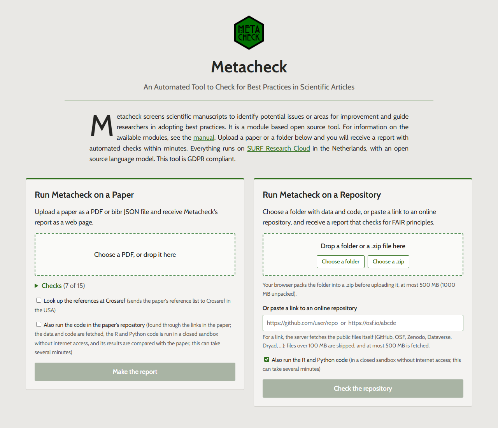
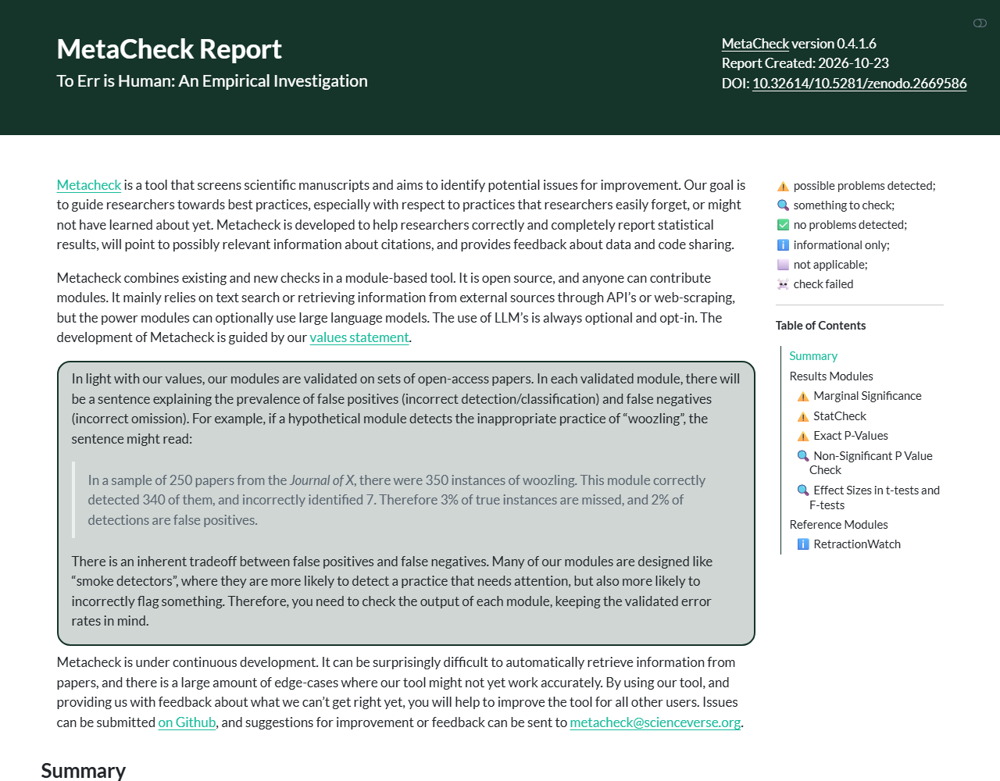
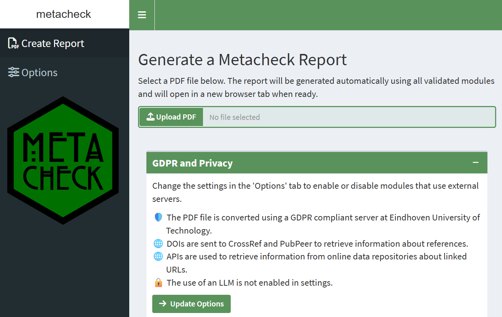
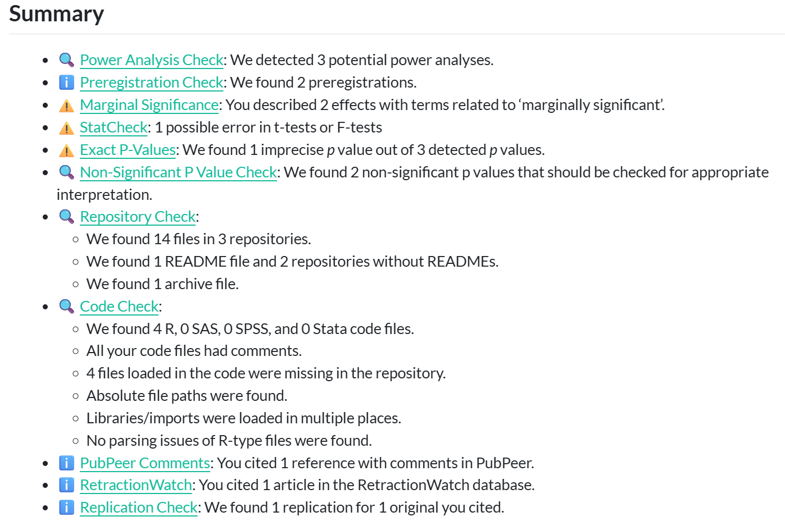
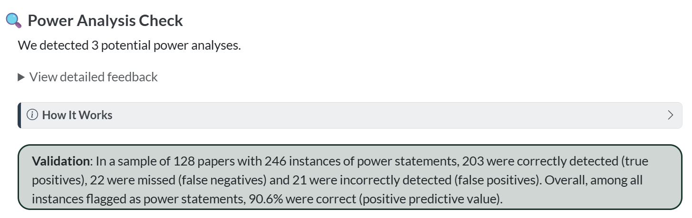

```{r, include = FALSE}
knitr::opts_chunk$set(
  collapse = FALSE,
  comment = "#>"
)
library(metacheck)
```


## The easiest way to get started

This manual mostly explains how to use Metacheck from R. If you do not want to install anything, use Metacheck's website on SURF Research Cloud instead. It runs on SURF's servers in the Netherlands: PDFs are converted to text on the server itself (in the paper report app you can also choose another converter), and the one check that uses a language model, the [power check](mod-power.qmd), uses an open-source model on the same server, so your paper is not sent to an external provider. The site is GDPR compliant.

The server offers these tools:

| Tool | What you can do with it |
|---|---|
| [Metacheck website](https://metacheckserve.metacheck.src.surf-hosted.nl/) | Upload a paper as a PDF or a bibr JSON file and receive a report. Or choose a folder of data and code, a .zip file, or a link to an online repository (GitHub, OSF, Zenodo, Dataverse, Dryad, and others), and receive a report on the data and code; the R and Python code can also be run, in a closed sandbox without internet access. |
| [TU/e Data Manager Check](https://metacheckserve.metacheck.src.surf-hosted.nl/datamanager/) | Compare a data package with TU/e's archiving guidelines, the way TU/e's data managers check it before a package is archived. |
| [ResearchBox Check](https://metacheckserve.metacheck.src.surf-hosted.nl/researchbox/) | Check the data and code in a ResearchBox. |
| [Paper report app](https://metacheckserve.metacheck.src.surf-hosted.nl/metacheck/) | Create a report from a PDF, choosing which modules to run and whether the power check uses the language model. |
| [Web interface](https://metacheckserve.metacheck.src.surf-hosted.nl/api/__docs__/) | Use the same tools from R, Python or the command line (see below). |

{fig-alt="Screenshot of the Metacheck website, with a box to run Metacheck on a paper and a box to run Metacheck on a repository"}

You receive the report as a web page in your browser, which you can save. The report starts with an explanation of Metacheck, a legend of the symbols for each check (a possible problem, something to check, no problem, information only), and a table of contents that lists every check with its result. Below that come a summary and the results of each check.

{fig-alt="Screenshot of the top of a Metacheck report, with the paper's title, an introduction, the legend of symbols, and a table of contents listing the checks and their results"}

The data manager check and the ResearchBox check use the modules that check shared data and code, such as [Data Check](mod-data-check.qmd) and [Code Check](mod-code-check.qmd).

Every tool can also be used from your own code through the web interface. For example, from a terminal:

``` bash
curl -F file=@paper.pdf https://metacheckserve.metacheck.src.surf-hosted.nl/api/report -o report.html
```

The [documentation of the web interface](https://metacheckserve.metacheck.src.surf-hosted.nl/api/__docs__/) lists all options.

The options of the server are more limited than running Metacheck from R: for example, you cannot set the parameters of a module. Uploaded files are deleted as soon as they have been read, and reports are kept on the server for one hour, so save a report you want to keep. For everything else, install Metacheck in R (see below).

You can also run Metacheck's website on your own computer, without installing R, with the Metacheck Docker image. The image contains the same website as on SURF Research Cloud (with the ResearchBox and TU/e Data Manager checks), the Shiny app, and a GROBID server, so a PDF is converted on your computer and is not sent to an external server. The website can also run the R and Python code of a repository, inside the Docker container. Install [Docker Desktop](https://www.docker.com/products/docker-desktop/), start it, and run in a terminal:

``` bash
docker run --rm -p 127.0.0.1:3838:3838 ghcr.io/scienceverse/metacheck_platform_docker
```

The first time, Docker downloads the image, which takes about 3 GB of disk space. When the terminal shows "metacheck is ready", open [http://localhost:3838](http://localhost:3838) in your browser for the website, or [http://localhost:3838/metacheck/](http://localhost:3838/metacheck/) for the Shiny app. To stop Metacheck, press Ctrl+C in the terminal.

For the optional LLM power check, the app uses [Ollama](https://ollama.com) on your computer, so the paragraphs are not sent to an external provider either. Install Ollama, start it, and download the model once with `ollama pull qwen3.5:4b`. On Linux, add `--add-host=host.docker.internal:host-gateway` to the `docker run` command, and let Ollama accept connections from Docker by starting it with `OLLAMA_HOST=172.17.0.1`.

## Installation

Before you install Metacheck, you need two things on your computer:

1. **R**, version **4.3.0 or newer**. Download it for your operating system from [https://cran.r-project.org/](https://cran.r-project.org/) and install it with the default options.
2. **RStudio** Desktop (the free edition), from [https://posit.co/download/rstudio-desktop/](https://posit.co/download/rstudio-desktop/). RStudio is not strictly required, but we assume it throughout this book. Recent versions of RStudio also bundle the Quarto command-line tool, which Metacheck uses to generate reports.

With R and RStudio installed, the recommended way to install Metacheck is from the **scienceverse R-universe**. R-universe provides ready-to-use, pre-compiled versions of Metacheck for Windows and macOS, so you do **not** need any additional build tools, and installation is a single command. Open RStudio and run:

``` r
install.packages("metacheck",
  repos = c("https://scienceverse.r-universe.dev", "https://cloud.r-project.org"))
```

This tells R to look for Metacheck on the scienceverse R-universe first, and to pull any other required packages from the regular CRAN mirror. On Windows and macOS this installs binary versions of every package, so nothing is built from source and the installation works on a fresh machine without any extra setup. The download includes Metacheck's dependencies, so on a first installation it may take a few minutes.

After installation, you can load the Metacheck library.

```{r}
#| eval: false
library(metacheck)
```

### Installing the development version

Metacheck is under active development. The development version often has new modules or functions before they reach the stable release. R-universe only ever hosts one build per package name per universe, so the development version is not available as a pre-compiled binary; install it directly from [GitHub](https://github.com/scienceverse/metacheck) instead. Installing this way builds Metacheck from source, which requires a compiler toolchain that does not ship with R by default:

- **Windows:** Install **Rtools**, matching the version to your R version (Rtools44 for R 4.4.x, Rtools43 for R 4.3.x, and so on), from [https://cran.r-project.org/bin/windows/Rtools/](https://cran.r-project.org/bin/windows/Rtools/). Use the default options. This is a large download.
- **macOS:** Install the Xcode command-line tools by running `xcode-select --install` in the Terminal. For some packages you may also need a Fortran compiler, available from [https://mac.r-project.org/tools/](https://mac.r-project.org/tools/).
- **Linux:** Install the standard development tools (for example `build-essential` and `gfortran` on Debian/Ubuntu), along with the development versions of system libraries such as `libcurl`, `libxml2`, and `libssl`.

With the build tools in place, install the `pak` package and then install Metacheck from the `dev` branch:

``` r
install.packages("pak")
pak::pkg_install("scienceverse/metacheck@dev")
```

To install a different branch, change the name after the `@`. A source install keeps the package name `metacheck`, so you load it as usual with `library(metacheck)`.

```{r}
#| eval: false
library(metacheck)
```

You can launch a simple shiny app that creates a report from a PDF, with options to control what information is sent to or retrieved from external servers. This shiny app will run a fixed number of validated modules. It also provides R code to transition to R, where you can use more functions of Metacheck. The shiny app is the best way to get started with Metacheck.

``` r
metacheck::report_app()
```

{fig-alt="Screenshot of the Metacheck Shiny app"}

In the Shiny app you can upload a local file, and the app will automatically generate a report with the results for all validated modules. The report presents a general introduction about Metacheck, our values, and our approach to module validation. This is followed by a summary of all modules.

{fig-alt="Screenshot of the Metacheck report summary"}

Following the summary, you can browse each module. Modules are discussed in more detail in later chapters. Each module provides a summary, a dropdown field with detailed feedback, a section that can be expanded explaining how the module works, and information about how the module was validated. An example of this overview in the report for the power module is in the screenshot below:


{fig-alt="Screenshot of the power module in the report"}

### Starting from a manuscript, or from a folder

`report_app()` and `report()` (its code-based equivalent, see [Creating a Report](creating-a-report.qmd)) both start from a manuscript: you upload or read a paper, and the modules follow the repository links it contains. Sometimes there is no manuscript at all — you just have a folder of files, downloaded from a repository yourself or sent to you directly for review. For that case, use `report_repository()` instead: give it a path, and it runs the repository-oriented modules (`repo_check`, `code_check`, `data_check`, `codebook_check`) directly on the folder and writes a report named after it.

```{r}
#| eval: false
report_repository("path/to/folder")
```

See [Checking Local Files](local-files.qmd) for worked examples, including downloading a repository's files yourself before running this.

### Running locally for privacy

Metacheck has been developed so that it can run locally, without sending any information anywhere. This requires a bit more technical expertise, but it makes the tool available to editors or peer reviewers who are not allowed to upload submitted manuscripts to an external server.

When such privacy concerns are not an issue (for example when running Metacheck on a publicly available preprint) you can use online servers for specific tasks, such as converting a pdf to xml. This offers an easier user experience. 

By default, `convert()` sends a PDF to Metacheck's own server on SURF Research Cloud in the Netherlands, which converts it with bibr when bibr is available, and otherwise with GROBID on the same server. That server needs no API key, deletes the uploaded PDF once it is converted, and deletes the result an hour later. Only when that server cannot be reached does Metacheck look for a local GROBID server, then a local bibr server, and then the first available server in a [list of active servers](https://www.scienceverse.org/metacheck/convert.json).

If you cannot send manuscripts to an external server, you can run your own local GROBID server following instructions from <https://grobid.readthedocs.io/>. The easiest way is to use Docker. The following code installs GROBID 0.9.0.

``` bash
docker run --rm --init --ulimit core=0 -p 8070:8070 lfoppiano/grobid:0.9.0
```

A running local GROBID server is **not** chosen automatically while the SURF server can be reached, so to keep the manuscript on your computer, name the local server when you convert: `convert(pdf_file, method = "grobid", api_url = "http://localhost:8070")`. The same principle applies to large language models: the recommended setup runs a model locally so no data is sent to an external service (see [Using Large Language Models](llms.qmd)).

See the [Reading in a Paper](reading-a-paper.qmd) chapter for the full details of converting and reading papers, including how to point `convert()` at a local server.

## Large language models

A few modules (notably [power](mod-power.qmd) and [prereg_check](mod-prereg-check.qmd)) can use a large language model to extract structured information from text. LLM use is **entirely optional and opt-in**, and the vast majority of modules work without any LLM. For how to turn LLM support on, choose a model, run one locally with Ollama, or use a cloud API, see [Using Large Language Models](llms.qmd).

## API keys and tokens for online repositories

The [repo_check](mod-repo-check.qmd) module and related functions can read files directly from repositories such as OSF, Zenodo, Dataverse, Dryad, Figshare, 4TU.ResearchData, and GitLab. For most of these an access token is optional and only raises how many requests you may make per hour, or gives you access to your own private material — the one exception is Dryad, where a token is required even to download files from a fully public dataset.

Each service issues its own token, which you store once in a file called `.Renviron` so R finds it automatically every time it starts. Step-by-step instructions, with screenshots, exist for [OSF](archiving-osf.qmd) and [Zenodo](uploading-to-zenodo.qmd); for Dataverse, Dryad, Figshare, 4TU.ResearchData, and GitLab, see [Getting API Tokens for Other Repositories](repository-tokens.qmd). LLM provider API keys (OpenAI, Anthropic, Groq, and so on) are a separate matter, covered in [Using Large Language Models](llms.qmd).
